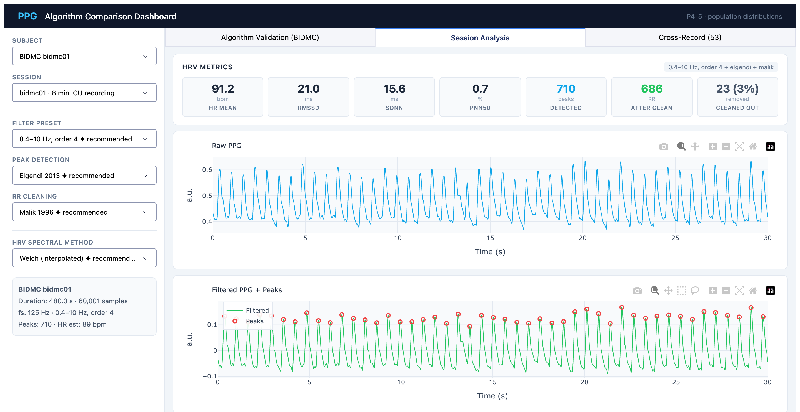
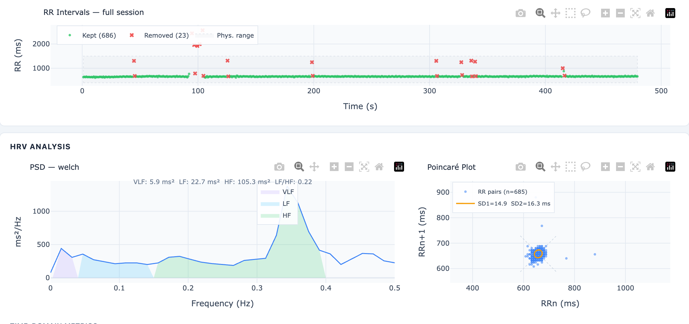
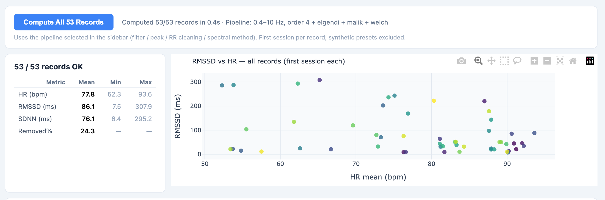

# PPG → HRV pipeline for wearable physiological data

A modular, test-backed Python pipeline that turns raw photoplethysmography (PPG) from a Shimmer3 GSR+ wearable into heart-rate-variability (HRV) metrics, compares alternative methods at every stage, and lets a researcher inspect each step in an interactive Dash dashboard. Companion modules cover accelerometer-based motion-artifact detection, PPG signal-quality indices (SQI) and electrodermal activity (GSR/EDA) decomposition.

I built it for my master's research on psychophysiological stress and recovery, where 66 participants wore a Shimmer3 GSR+ (PPG, 3-axis accelerometers and skin conductance at 256 Hz) during baseline, stressor, nature-exposure and recovery phases. **Those recordings are not part of this repository** (see [Data and privacy](#data-and-privacy)). Everything here runs on synthetic signals or the public BIDMC dataset.

The design principle throughout: every method choice must be justified by how its error propagates to the final metric. A peak detector with a good heart-rate error can still ruin RMSSD, so heart-rate error and RMSSD error are always reported together.

## Pipeline

```
raw PPG ─► band-pass filter ─► peak detection ─► RR intervals ─► RR cleaning ─► HRV
            (Butterworth,       (Elgendi /         (ms)          (physiological+3SD /   time domain
             zero-phase)         Bishop /                          Malik / Karlsson)     frequency domain (Welch / AR-Burg / Lomb–Scargle)
                                 prominence)                                             nonlinear (Poincaré SD1/SD2)
accelerometer ─► per-axis gravity removal ─► motion mask        ─┐
PPG window    ─► template correlation / spectral entropy SQI    ─┴► quality flags (standalone modules, see Limitations)
skin conductance ─► low-pass split ─► tonic SCL + phasic SCR events
```

| Module | Methods compared | Reference |
|---|---|---|
| [`pipeline/baseline.py`](src/pipeline/baseline.py) | polynomial detrend, high-pass, moving median | Orphanidou et al. 2015 |
| [`pipeline/filter.py`](src/pipeline/filter.py) | Butterworth band-pass presets (0.4–10, 0.5–8, 0.5–5 Hz); zero-phase vs causal | Elgendi et al. 2013 |
| [`pipeline/peaks.py`](src/pipeline/peaks.py) | Elgendi two-moving-average, Bishop & Ercole multi-scale, scipy prominence; shared dicrotic-notch de-duplication | Elgendi 2013; Bishop & Ercole 2018 |
| [`pipeline/rr_clean.py`](src/pipeline/rr_clean.py) | physiological range + iterative 3 SD, Malik 20 % rule, Karlsson median filter | Task Force 1996; Malik 1996; Karlsson 2012 |
| [`pipeline/rr_interpolate.py`](src/pipeline/rr_interpolate.py) | cubic spline, quadratic, linear (4 Hz, no extrapolation) | Task Force 1996 |
| [`pipeline/hrv_time.py`](src/pipeline/hrv_time.py) | MeanNN, SDNN, RMSSD, pNN50 (N−1 denominator), HR | Task Force 1996 |
| [`pipeline/hrv_freq.py`](src/pipeline/hrv_freq.py) | Welch, AR-Burg (own implementation), Lomb–Scargle; VLF/LF/HF | Task Force 1996; Marple 1987 |
| [`pipeline/hrv_nonlinear.py`](src/pipeline/hrv_nonlinear.py) | Poincaré SD1, SD2, SD1/SD2, ellipse area | Brennan et al. 2001 |
| [`pipeline/motion.py`](src/pipeline/motion.py) | per-axis high-pass RMS threshold, rolling-variance | Salehizadeh et al. 2014; van Hees et al. 2013 |
| [`pipeline/sqi.py`](src/pipeline/sqi.py) | template-correlation SQI, spectral-entropy SQI, windowed SQI | Orphanidou et al. 2015; Li & Clifford 2012 |
| [`pipeline/gsr.py`](src/pipeline/gsr.py) | SCL/SCR low-pass decomposition, SCR onset and amplitude | Boucsein et al. 2012 |
| [`io/shimmer_reader.py`](src/io/shimmer_reader.py) | Shimmer ConsensysPRO export variants, timestamp-based sampling-rate check | — |
| [`validation/`](src/validation) | sum-of-Gaussians synthetic PPG with dicrotic wave, noise, drift and motion; BIDMC loader with ECG R-peak reference | Pimentel et al. 2017 |
| [`comparison/runner.py`](src/comparison/runner.py) | end-to-end grid on BIDMC against ECG ground truth | — |
| [`dashboard/app.py`](src/dashboard/app.py) | Dash + Plotly inspection UI | — |

All signal-processing parameters live in [`config.yaml`](config.yaml), each with its source and a note on which way to move it for a different sensor site or population.

## Validation

### End-to-end on public data (BIDMC, 53 ICU recordings)

The [BIDMC PPG and Respiration Dataset](https://physionet.org/content/bidmc/1.0.0/) provides 8-minute fingertip PPG at 125 Hz with simultaneous ECG. ECG R-peaks (NeuroKit2, Hamilton detector) are the reference. Filtering is fixed at Butterworth 0.4–10 Hz, order 4, zero-phase; 2 peak detectors × 3 RR cleaners = 6 combinations × 53 records = 318 evaluations. Bishop's detector was excluded here because its multi-scale search is O(N²) and did not finish on a single 8-minute record; it is compared on synthetic data only.

| Peak detector × RR cleaner | HR MAE median (p75), bpm | RMSSD error median (p75), ms | Beat F1 median (p25) |
|---|---|---|---|
| **Elgendi × Malik** (selected) | **4.97** (24.77) | **24.44** (75.62) | **0.946** (0.821) |
| Elgendi × Karlsson | 4.97 (24.77) | 25.93 | 0.946 |
| Elgendi × physiological+3SD | 4.97 (24.77) | 36.48 | 0.946 |
| Prominence × Karlsson | 5.71 | 30.61 | 0.944 |
| Prominence × Malik | 5.71 | 30.72 | 0.944 |
| Prominence × physiological+3SD | 5.71 | 31.51 | 0.944 |

HR MAE is computed over 30-s windows; beat F1 matches PPG peaks to ECG R-peaks after per-record pulse-arrival-time correction (±150 ms). Full numbers: [`results/bidmc_summary.csv`](results/bidmc_summary.csv) and [`results/bidmc_per_record.csv`](results/bidmc_per_record.csv).

**How to read these numbers honestly.** The pipeline does *not* meet the targets I set in `config.yaml` (HR MAE < 2 bpm, F1 > 0.95, RMSSD error < 5 ms). The test gate it passes is looser (HR MAE < 5 bpm, RMSSD error < 30 ms, F1 > 0.90). The error distribution is bimodal: about half of the records have HR MAE below 5 bpm, while about a quarter exceed 25 bpm, where the PPG itself is poor (e.g. bidmc16: 307 PPG peaks against 718 ECG beats). The largest RMSSD errors come from records whose ECG RR series is itself highly irregular, consistent with arrhythmia in this ICU population. RR cleaning does not change HR MAE or F1 (both are set by peak detection) but changes RMSSD error by up to 12 ms, which is why the cleaner was selected on RMSSD.

### Component tests on synthetic signals

Each module has a standalone validation script in [`tests/`](tests) that prints PASS/FAIL checks. Key results (synthetic PPG at 256 Hz, seed 42):

| Component | Result |
|---|---|
| Band-pass filter | ≤ 0.003 dB loss at 1 Hz, ≥ 51.7 dB attenuation at 0.1 Hz; zero-phase peak-timing error 0.335 ms vs 46.9 ms for the causal filter |
| Peak detection | after de-duplication all three detectors F1 ≥ 0.993 (clean, noisy, 90 bpm); best peak-timing MAE 0.056 ms |
| RR cleaning (5 % ectopic beats) | ectopic recall 1.000 for all methods; best RMSSD error 0.237 ms |
| HRV time domain vs NeuroKit2 | RMSSD error 0.044 ms, SDNN 0.045 ms, pNN50 0.000 % (after fixing the N vs N−1 denominator) |
| HRV frequency domain vs NeuroKit2 | Welch LF/HF relative error 0.85 %; AR-Burg and Lomb–Scargle within 4.7 % and 0.7 % of Welch |
| Poincaré vs NeuroKit2 | SD1 error 0.032 ms, SD2 error 0.129 ms |
| Motion detection | F1 0.983 (both methods), 0 % false positives at rest |
| SQI (clean vs SNR 0–3 dB windows) | AUC 1.000 (template correlation), 0.925 (spectral entropy) |
| GSR decomposition | SCL correlation 0.990, 3/3 injected SCR events detected, 0 spurious SCR/min at rest |
| Shimmer reader | three export formats and truncated-timestamp fallback, on generated Shimmer-style CSVs |

## Quick start

Python 3.12.

```bash
python3.12 -m venv .venv
.venv/bin/pip install -r requirements.txt
.venv/bin/python scripts/download_bidmc.py   # ~33 MB from PhysioNet into data/bidmc/
.venv/bin/python scripts/run_tests.py        # every validation script, with a summary table
.venv/bin/python scripts/bidmc_report.py     # regenerates results/bidmc_*.csv
.venv/bin/python src/dashboard/app.py        # http://127.0.0.1:8050
```

Without the BIDMC download, the BIDMC tests report `SKIPPED` and the dashboard offers synthetic signals only. The two scripts that need the original Shimmer recordings (`test_shimmer_reader.py`, the real-data part of `test_gsr.py`) also report `SKIPPED`.

To use your own Shimmer3 exports, place subject folders (`1/`, `2/`, … each containing ConsensysPRO CSVs) under `data/shimmer/` or point `SHIMMER_DATA_ROOT` at them. `.gitignore` keeps them out of version control.

## Dashboard

The dashboard lets a researcher pick a record, switch filter preset, peak detector, RR cleaner and spectral method from the sidebar, and see every stage recomputed: raw and filtered PPG with detected peaks, the RR series with removed intervals marked, PSD with VLF/LF/HF bands, the Poincaré plot with SD1/SD2 ellipse, and a cross-record table and scatter. A third tab summarises the BIDMC comparison above.

Screenshots (BIDMC and synthetic data only):





## Data and privacy

- The Shimmer recordings from my master's study are **not** included, nor is anything derived from them (per-participant metrics, figures or logs). Whether the study's ethics approval permits public release has not been confirmed, so nothing is released.
- `.gitignore` is a whitelist: only source, tests, scripts, this README, `config.yaml` and the BIDMC result tables can be committed, and raw-signal file types are blocked everywhere.
- Shimmer session labels in the dashboard are neutral indices, because the device software writes participant initials into file names.
- BIDMC data are downloaded from PhysioNet at run time and not redistributed here.

## Limitations

- SQI, motion and GSR modules are validated on synthetic signals but are not yet wired into the BIDMC comparison or the dashboard; the end-to-end numbers above use no quality gating.
- Filtering is zero-phase (offline). A causal filter shifts peaks by about 47 ms on synthetic data, so a real-time version would need delay compensation and re-validation.
- BIDMC is an ICU population at rest. Performance on ambulatory wrist or finger PPG during movement is not established here.
- The dicrotic-notch de-duplication window (600 ms) assumes HR ≤ 100 bpm.
- Lomb–Scargle absolute band powers are not on the same scale as Welch and AR-Burg (on bidmc01, total power 1279 vs 142 ms²), although LF/HF agrees (0.195 vs 0.216). The synthetic tests compare ratios and normalised powers only, so compare methods on those, not on absolute ms².

## Implementation and validation notes

Several design decisions came from that review, for example fixing the pNN50 denominator, removing extrapolation from RR interpolation, and switching motion detection from "combine axes, then high-pass" to "high-pass each axis, then combine". Preparing this public version surfaced one more bug: a NumPy 2 compatibility shim in the tests had hidden that band-power integration still called the removed `np.trapz`, so the dashboard showed no frequency-domain values. It now uses `np.trapezoid`.

## References

- Task Force of the ESC and NASPE (1996). Heart rate variability: standards of measurement. *Circulation* 93:1043–1065.
- Elgendi M et al. (2013). Systolic peak detection in acceleration photoplethysmograms. *PLoS ONE* 8(10):e76585.
- Bishop SM, Ercole A (2018). Multi-scale peak and trough detection optimised for periodic and quasi-periodic neuroscience data. *Acta Neurochir Suppl* 126:189–195.
- Karlsson M et al. (2012). Automatic filtering of outliers in RR intervals before analysis of HRV in Holter recordings. *Biomed Eng Online* 11:2.
- Brennan M et al. (2001). Do existing measures of Poincaré plot geometry reflect nonlinear features of HRV? *IEEE Trans Biomed Eng* 48(11):1342–1347.
- Orphanidou C et al. (2015). Signal-quality indices for the electrocardiogram and photoplethysmogram. *IEEE J Biomed Health Inform* 19(3):832–838.
- Boucsein W et al. (2012). Publication recommendations for electrodermal measurements. *Psychophysiology* 49(8):1017–1034.
- Pimentel MAF et al. (2017). Toward a robust estimation of respiratory rate from pulse oximeters. *IEEE Trans Biomed Eng* 64(8):1914–1923. Data: PhysioNet BIDMC, ODC-By 1.0.
- Makowski D et al. (2021). NeuroKit2: a Python toolbox for neurophysiological signal processing. *Behav Res Methods* 53:1689–1696.

## License

Code: [MIT](LICENSE). The BIDMC data are not redistributed; they remain under the Open Data Commons Attribution License v1.0 via PhysioNet.
